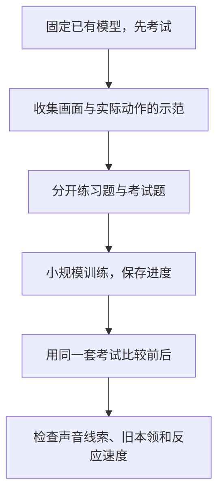

# 01：这一晚怎样训练和测试模型

实验：2026-10-26晚至27日08:00；教学补写：2026-10-27。

这一晚的目标，是把“模型看画面、选动作、接受训练、参加考试”这条链真正跑起来，再找出它哪些地方进步、哪些地方退步。我们使用本机已有的 GameScaling 模型，没有从零训练一个大模型，也没有操作真实原神客户端。

## 整条流程

可以把模型想成一位已经学过一些游戏的学生。我们给它准备练习题和考试题，再检查练习后的变化。

这里的“考试”叫**评测**。正式的未见题不参与这轮学习；训练题上的自检另行标明。比较前后时保持题目相同，避免只是换了一套更容易的题。

## 先检查模型原来会什么

**RGB**就是普通彩色画面，来自红、绿、蓝三个颜色通道。最初我们用自行生成的红蓝色块图片，规定红色选W、蓝色选S，先检查已有模型是否能按规则输出动作。

原模型在固定的六张检查图上，动作格式合法，但规则匹配是0/6。这相当于学生能按要求填写答题卡，却把答案填错。它不等于模型在所有游戏中都不会行动。

这六图检查包含训练、验证、测试各两张：训练两张属于练习数据，后两组不参与更新。因此不能把整个6/6检查都称为“没见过的题全对”。

同时记录模型版本、图片、规则、以前动作的数量和耗时。这份学习前的成绩叫**基线**：之后所有“改善”都需要与一个清楚的起点比较。

## 练习题从哪里来

我们自己写了一个小型网格游戏，主要有三类规则：

- reach：走到目标。
- hazard：走向目标，同时避开危险。
- keydoor：先拿钥匙，再去门口。

一个知道游戏内部状态的示范程序负责给出动作并实际执行，再记录画面、按了什么、什么时候开始和结束、最后发生什么。这里的“示范者”是按规则写的程序，不是人整晚手动玩游戏。

模型作决策时的玩家观测只含允许的画面和规则，不把内部位置或答案塞进决策提示。训练时，正确动作另外作为**监督标签**，让程序计算损失并调整参数；考试时不提供这个答案。类似老师批改作业时对照答案，但考试不能把答案一起发给学生。

为什么先用小型游戏？它的规则和结果可检查，能分清问题来自画面、数据、训练还是动作执行。代价是它比真实大型游戏简单得多，成功不能直接推广到真实游戏。

本轮游戏还会在模型思考时暂停。它适合检查决策有没有学会，却不能证明模型跟得上持续运动的真实世界。

## 数据为什么不能随便保存

一条示范至少要说清：当时看到了哪张图、真正完成了什么动作、执行时间、结果，以及数据的来源和使用许可。

例如模型建议向前，但程序没有执行，就不能把“向前走过”写成事实。部分执行或失败执行也不能冒充完整示范。

还要防止**数据泄漏**：练习题与考试题过于重合，让考试看起来很高分。相邻帧或同一段经历不能随机拆开分到两边；这里按声明的游戏划分，检查完整经历和相同像素是否跨集合。检查不能自动识别所有裁剪、压缩或相似场景，所以还不等于真实数据去重问题已经全部解决。

具体格式和检查程序见[数据合同](../data-contract.md)与[训练入口](../training.md)。

## 模型具体怎样学习

**模型权重**是一大批从训练中学到的数字。训练会调整这些数字，使模型更倾向于给出示范答案；修改配置文件本身不会让模型学会动作。

我们复用已有的0.8B模型，约有8亿个参数。**LoRA**是一种小幅适配方法：固定原有权重，训练较小的一组附加参数。可以把它理解成给原来的知识加一份可学习的补充笔记。补充笔记文件叫 adapter；单独拿它不能替代原模型。

**SFT，监督微调**，就是给出“画面和规则→正确示范动作”，让模型学习模仿。程序比较模型预测与示范答案，得到一个叫**损失**的数值；损失反映这个训练目标上有多不吻合。随后调整可训练参数，这次调整称为一次**更新**。

我们先跑几次更新，确认真的产生了有限、非零的学习信号，能保存进度，显存和耗时也合适，再继续训练。

先做的颜色规则实验实际完成32次更新，六张固定检查图从0/6变成6/6。这证明训练链条确实能学习这个很简单的规则，叫**冒烟测试**，不代表已经会玩复杂游戏。

随后用reach任务的64条实际示范动作，完成128次更新，再运行预先固定的实际游戏回合：

| 自有任务，每类四局 | 原模型 | 文本SFT128后 |
|---|---:|---:|
| 走到目标 | 2/4 | 4/4 |
| 避开危险到目标 | 0/4 | 4/4 |
| 拿钥匙再到门口 | 0/4 | 3/4 |

128次更新不等于128条不同示范：训练可以重复使用已有数据。考试题也没有因此变成128局。钥匙门失败的一局被保留，不能删掉后只展示成功录像。完整经过见[反馈与SFT结果](../feedback.md)。

## 如何检查中断后还能接着学

**检查点**是学习进度存档。除了模型参数，还要保存调整参数的方法当前走到了哪，以及随机过程的状态；只存最后的答案文件，不一定能原样接着学。

最初的恢复对照是“先练4次、存档、恢复再练28次”对比“连续练32次”，没有逐位一致，失败记录保留。排查后启用适合本轮环境的确定性设置，再做“连续练4次”对比“练2次、存档、重新启动再练2次”，才得到参数和训练状态逐位一致。

后续还做了连续8次与4次加恢复4次的对照，跨过“第8次缺少声音”的情形。两组恢复测试在这台机器和固定环境里逐位一致；换显卡或软件后不能直接沿用这个保证。

## 怎样让它利用声音线索

**多模态**指多种信息来源，例如画面加声音。这里给自制环境生成了两种音调，再把一小段声音画成**频谱图**：横向表示时间，纵向表示频率，颜色表示强弱。已有视觉模型能接收图片，于是我们把游戏画面和频谱图作为两张输入图交给它。

所以这是“通过图片表示声音”，没有给模型装上原生波形耳朵，也没有证明它听懂真实游戏音效。

关键实验是让相同画面对应不同音调和正确方向。这样只看画面无法一直答对，模型必须利用声音线索。

第一轮128次更新没有建立融合收益：模型一直选同一个方向。在新的预先固定方案中，两组各训练200次，每次累积四条示范，共各800次标签使用；对齐声音时两组都能16/16成功，交换音调后都0/16，移除一个信息来源后各8/16。

这里的“交换、移除某种输入再考试”叫**消融对照**：检查好成绩是否真的依赖那条信息。更新次数、组批和数据曝光同时发生变化，不能把改善只归因于某一个改动。完整方案见[平衡音频训练](../audio-batch.md)。

另一个诊断是保持视觉提取部分不变，只训练一个新的小型决策模块。它也在人工任务里利用了两张图，但绕过了原语言动作解码器，所以新模块成功不能替代原模型适配成功；见[冻结视觉读出](../vision-readout.md)。

## 如何发现它忘了旧本领

学新任务可能让旧任务变差，这里称为**遗忘**。声音任务变好后，我们另外考了标准的纯画面任务，确实发现损伤。

接着固定同一个已经学过声音的模型，做两组后续训练，各64次更新：

- 一组继续练声音题，作为对照。
- 另一组练相同声音题，再额外复习旧的画面题，称为**RGB重放**。

后一组多用了示范和计算，不能把它当成同成本比赛。

最新完整对照共320局、413次实际动作。复习组恢复了全部4个原来会做的reach题，但hazard虽然总成功达到6/8，原来会做的两题仍全部失败，而且踩了危险。声音迁移题也从8/8降到6/8。

因此结果是“复习帮助了部分旧能力，同时还有损伤”，不是“遗忘已解决”。如何读这个看似矛盾的成绩，见[第02篇](02-terms-and-results.md#为什么成功率提高了仍可能退步)。

## 为什么能加快判断，却还没做到流畅实时

原模型通常要一个词接一个词地写完整动作文本。我们在另一项固定权重实验中限制答案，只从W/A/S/D/不动五种整块动作里选，再由程序填写动作文本，省去逐字生成。

36对保存图请求中，处理中位数约从1.99秒到0.163秒，动作保持一致。但这种模式不能直接表达鼠标、组合键或块内变化，因此没有把它替代为通用默认模式。

实际回合还需要保存图片、处理输入和执行动作。首键模式下，采样到动作结束的中位数约0.478秒；世界还在推理时暂停，离持续实时控制仍有距离。

还测了精确频谱特征缓存：相同声音图片和编码器身份命中时复用已算结果。中间处理更快，但实际最慢一批请求的情况没有变好。最后用已有计时模拟排队，发现“只处理最新帧”减少积压却会丢帧；这是CPU模拟，没有新增在线游戏收益。完整边界见[时延说明](../latency.md)。

## 为什么还做了一步奖励学习

监督训练给正确示范；**奖励学习**让模型做选择，再看环境给的分数。我们比较过各128次更新的一步奖励学习与分类SFT，主评测总分和动作相同，没有证明奖励方法更好。

它只有一步选择，不是让模型连续探索很长一段游戏。复杂的**强化学习（RL）**还涉及连续行动和延迟回报；本轮没有完成这种顺序训练，见[一步学习对照](../feedback-learning.md)。

## 读完后试着回答

1. 六张颜色图全对，为什么还不能宣布会玩原神？
2. 为什么练完声音题，还必须再考以前的纯画面题？
3. 0.163秒这个数字没有包含哪些事情？

答案提示：训练链条、任务收益、泛化与实时反应是不同考核；新任务可能损伤旧能力；保存图处理不包含完整真实采样、排队和动作执行。下一篇会用具体数字继续解释。
